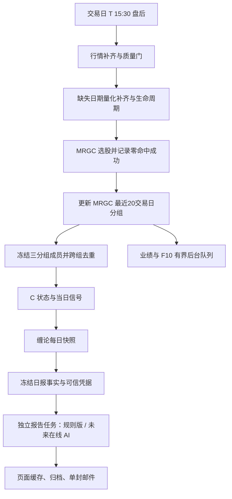

# 三分组日报接入交易日工作流方案

状态：已获批准并实施，2026-10-03。采用规则版，无模型调用；验收不发送真实邮件。

## 目标和现状

以交易日 T 为唯一业务日期，行情、策略、成员、C 状态、缠论候选、报告和投递全部引用同一 T。新增每日一封三分组日报，保留低吸、持仓与盘中提醒各自的流程。

现有正式入口是 `backend/scripts/run_local_data_skill.py` → `run_daily_data_workflow.py`，不另建 `auto_pipeline.py` 调度。安装器当前配置：09:00 晨间补齐、09:30 health、09:35 盘中监控、15:30 daily、16:30 retry、20:00 evening、22:30 邮件 retry。实际启用状态在实施时再以 launchctl 核验。技能文档旧时间不作为安装依据。

已有三分组规则报告、C/缠论机会分类、页面联动与邮件预览；尚未接入三分组自动投递。公司和自选股目前按当前成员读取；缠论候选读取时计算、仅进程缓存。在线模型未启用，本地 Codex 已撤回。第一版自动链使用规则版；未来在线模型仅增加解释，不改写信号。

## 工作流

量化步骤遵循现有任务依赖顺序，不为图示调整已有计算顺序。新增日报依赖全部完成的就绪凭据；失败只阻断依赖链，不将已有行情计算误记为失败。财务队列不能与正式 SQLite 写库并发争锁。

## 日期、成员与事实契约

1. T 来自交易日历及显式任务目标，非交易日退出；迟到任务继续明确的 T，禁止静默借用最新日。历史 catchup 默认 `send=false`。
2. MRGC 窗口含 T 的最近20个真实交易日，每日策略均有 success 记录，包括零命中。缺记录时分组不可信。
3. 成员冻结存三组标识、成员代码、来源及冻结时间；唯一代码集只计算一次，报告保留全部 group_ids。冻结后手工改组影响下一交易日；显式重建生成新 revision，已发送日不自动补发。历史首次补算无法还原公司/自选股历史成员时明示“补算时成员”，不得声称当时成员。
4. C 快照包含确认、模拟持有、退出、失效、风险、新增/持续状态及规则版本。继续区分历史 MANUAL 与正式结果：自动投递使用本次正式快照；页面按 report_id 查看同份冻结报告，历史交互结果另标口径。
5. 缠论快照保存 T、symbol、公式版本、行情指纹、结构/候选、pivot_date、first_visible_date、方向、计算状态。沿用页面公式并做跨语言一致性测试；回绘候选不能称为不可回绘的实盘确认。历史修复使指纹变化时新建版本并重新核验。
6. 延续现有分类：当日 C 确认/退出与近3交易日同方向首次可见缠论候选为共振；C 单策略、缠论单策略、方向冲突和风险分别列出。候选窗口、公式、C 配置哈希必须进入报告版本，不将重合分组解释为收益保证。
7. 报告保存 counts、groups、stocks、sectors、opportunities、warnings、来源与版本。跨组统计可重复，总览按代码去重；三视图及 HTML 均从同一冻结对象生成。

## 就绪、AI、投递与归档

建议最小持久化对象：日报运行/成员快照、缠论每日快照、冻结报告及就绪凭据；优先复用现有表和迁移机制。凭据关联 T、report_id、revision、成员哈希、数据指纹、C/缠论版本及可信检查结果，独立报告任务只能消费验证通过的凭据。

必要行情/C/缠论缺失、失败、日期错位或成员覆盖不全 → BLOCKED，不投递完整日报；页面可显示标明缺口的局部规则结果。所有成员成功且结果为空是合法零机会，不能因零机会阻断。低上市时长使用明确 unsupported 状态与原因；是否允许投递须由契约明确，不能悄悄遗漏该股票。

Data Core 保持 `EVOALPHA_DISABLE_LLM=1`，不继承模型凭证。独立任务第一版直接生成规则版、页面缓存及归档。未来配置在线 API 后按冻结事实生成 AI：超时/解析失败回退标明规则版，AI 不得创造股票、日期、价格或交易信号；校验不通过不使用模型输出。事实完整但 AI 失败不影响 Data Core 成功。

投递去重键建议 `three_group_daily:T:recipient_set_id`，与低吸/持仓键隔离，报告 revision 和规则/AI版不进入自动补发键。复用 dispatcher 投递记录与邮件 UI；保存最终 HTML、事实 JSON、生成时间及投递状态。重试复用已冻结内容，发送前检查日期、可信性、失效与既有发送记录。SMTP 成功但进程在记账前崩溃存在投递不确定性：进入 UNKNOWN 待核对，不能盲目重发；仅本地去重不能保证 SMTP 端恰好一次。

归档按 T/report_id 有界保存，不覆盖已发送正文。保留期建议180天，运行日志单文件20MB上限，已有重要手工归档保留；清理只针对本功能目录。

## 每日调度和恢复

| 时间/触发 | 行为 |
| --- | --- |
| 15:30 daily | 既有 Data Core → MRGC → 成员冻结 → C → 缠论 → 事实冻结；可信后立即提交独立报告任务并投递 |
| 16:30 retry | 缺失任务补齐，复用冻结成员；首次可信后立即提交，同日已发送跳过 |
| 20:00 evening | 保留旧摘要，并对三分组未完成日报限次补试；AI失败或未配置发送明确规则版 |
| 22:30 retry | 重试明确失败投递；再次检查 T 与有效性，UNKNOWN 不自动重发 |
| 历史补算 | 计算与留档默认开启，邮件默认关闭 |

无需新增常驻轮询。独立任务通过现有 launchd 单次启动能力或已验证的短任务机制触发，不用 Codex 自动化承载。每 T 每阶段最多首次+2次重试，指数退避且到窗口结束退出；失败保留原因供下一现有窗口补试。电脑休眠/注销不保证15:30准点执行，现有补跑逻辑应核对尚未完成的交易日，禁止用常驻防休眠补偿。

## 分批实施与文件范围

每批拆成最多3个实现文件的小任务，完成回归后继续；测试文件随小任务提交，最终接调度。

| 批次 | 改动范围（以实施核对为准） | 验收 |
| --- | --- | --- |
| 一：缠论落库 | `quant_engine/watch/chan_daily_confirmation.py`；新增缠论快照执行器；现有数据库迁移入口 | 公式一致、首次可见正确、失败/空结果可区分、重跑幂等 |
| 二A：成员与事实 | `mrgc_daily_report.py`；新增冻结存储模块；`app/api/v1/watch.py` | 三组去重、版本可追溯、历史成员标注、日期严格 |
| 二B：解读与投递 | `mrgc_report_ai.py`；`dispatcher.py`；新增独立日报任务入口 | 规则版先行、单封去重、失败恢复、HTML与页面一致、归档 |
| 二C：页面 | `MrgcDailyReportPanel.tsx` 及必要报告类型 | 三视图同report_id、缺口可见、联动状态不重置 |
| 三：调度 | `run_daily_data_workflow.py`；`run_local_data_skill.py`；`install_local_data_launchd.py`，另分小任务接 evening | 接入15:30/16:30/20:00/22:30，不改旧提醒口径 |

新增各模块至少覆盖 happy/edge/error；bug遵循先失败回归。此方案不安装在线凭证；未来在线 API 另行配置。

## 风险、资源预算与验收

主要风险：ZIG回绘、成员变化、历史行情修复、多个写库任务、模型事实漂移、SMTP投递不确定、电脑错过时点。分别以首次可见、成员冻结、版本指纹、单实例锁与短事务、事实校验、UNKNOWN状态、现有补跑窗口处理。

单实例，BLAS/OMP/MKL/NumExpr/Accelerate线程1；缠论沿用最多520根历史，每次顺序处理唯一成员，不能构造全市场×历史日期笛卡尔积。预算目标：新增任务峰值RSS≤300MB、后台空闲CPU近0、无新增周期唤醒；缠论批次超时120秒起步，按实测调整，不通过放开并发补偿；未来模型单次90秒、输出128KB以内。财务队列串行、有界批次与请求超时，重试退出不无限排队。预算不是已测结果，实施交付提供实际峰值/稳定态RSS、CPU/线程、耗时、句柄、WAL、归档增长和请求数。

验收：同T全链日期一致；20日零命中记录；三个分组重叠只算一次；成员改动/历史修复可追溯；C/缠论失败不发完整邮件；合法零机会可发；重复触发/规则后AI成功不追加；已发送/失效/跨日失败安全跳过；SMTP不确定不盲发；历史默认不投递；三视图与归档HTML一致；低吸、持仓、盘中链回归通过。先临时库与假邮件transport验证，再生产只读dry-run，对齐页面，最后启用正式自动投递并核验资源。前端如有修改采用独立目录预构建、通过后原子切换。

实施审批：依据 AGENTS.md 的“先完整描述方案、文件列表、风险、步骤，等我批准”，本文整理完成后等待方案确认，再修改运行代码及调度。

## 实施验收记录（2026-10-03）

新增 `chan_daily_snapshot.py` 与 `three_group_daily.py`。日报执行器先冻结成员、补齐正式 C、保存缠论快照，再写就绪报告；页面读取现有日期归档。规则版明确标记完整，在线 API 留待未来启用。历史行情修订触发 C 输入指纹失效；Chan 任一必要成员失败阻断完整日报。

流程接入原 daily/retry，在 Data Core 验证后独立投递；20:00/22:30沿用旧任务标签。实际安装配置核对：15:30、16:30、20:00、22:30。仅更新 `com.evoalpha.watch.retry` 的加载配置，其它已有入口直接复用更新后的代码。未新建常驻进程。

旧 dispatcher 重试排除三组类型，发送不确定状态保留 UNKNOWN；规则版发送后不追加AI邮件。F10复用六年补齐队列，正式工作流持锁时延后，单批25股/最多600秒、单股120秒，与正式写库互斥。

集中相关测试113项通过；调度/晚间/安装器127项通过，旧邮件重试51项通过（集合有重叠，不能相加作为去重测试数量）。语法检查通过。

真实2026-09-30行情临时副本端到端：MRGC69、公司15、自选33，总览去重104；首次21.422秒，重跑0.505秒复用同report_id，归档valid；峰值RSS150,241,280字节，临时数据副本31,092,736字节，测试后删除。缠论独立首算16.457秒、复用0.185秒、峰值RSS42,418,176字节，104股快照临时库126,976字节。无模型请求、无真实SMTP发送；无新增常驻唤醒。

资源限制：报告与发送正文各50MiB总预算，单文件2MiB；当前交易日执行180天本功能运行记录清理，手工历史归档使用现有50MiB预算，不误删手工留档。SQLite短事务和显式关闭，SMTP前释放连接；任务180秒超时。生产端到端真实投递仍须下一交易日核对发送回执，当前验收只证明可信事实和模拟投递闭环。

最终补验：发送正文/报告版本首次发送前独立冻结，17项执行器测试与旧重试/归档合计26项通过。正式库已生成2026-09-30规则报告和104份缠论快照，页面GET返回COMPLETED/READY、归档valid，HTTP200约38ms；三组投递记录0条。新增运行报告JSON+HTML约326KB，日期归档总约832KB，验收时数据库WAL约5.2MB；所有测试/报告进程已退出。历史成员明确标 backfill_time_members，不声称重建公司/自选股历史成员。
