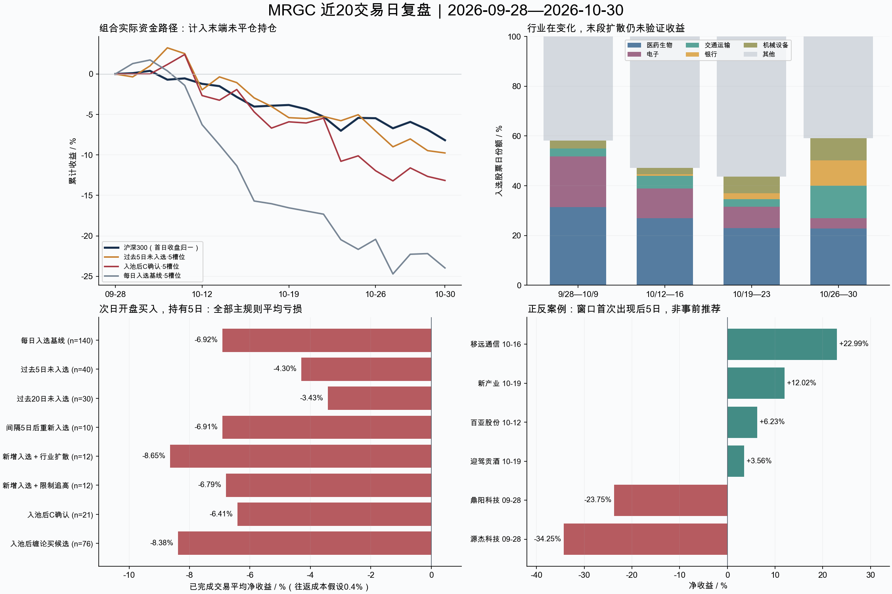

# MRGC 近20交易日复盘与短线策略检验

研究日期：2026-11-02。数据截至：2026-10-30。

**结论：这轮没有挖掘到可以称为“短期高胜率”的可执行策略。MRGC入选、行业扩散、C确认、缠论候选四类线索，均不足以在这一轮弱市里形成稳定的扣费盈利。建议继续把MRGC用于建立观察范围，不把这些规则直接升级为自动买入。**

这不是说所有股票都没有机会。移远通信、新产业、百亚股份、迎驾贡酒有过不同幅度的反弹，但把赢家的共同点写成规则后，必须连同失败股票一起计算，不能只复述成功案例。

[打开全部135只股票的可搜索复盘明细](report.html) · [研究预设口径](protocol.md) · [逐股CSV](stock_review.csv) · [全部入选日及后续收益](hit_outcomes.csv) · [全部信号及随后表现](signal_outcomes.csv)

## 1. 数据覆盖和时间口径

- 20个真实交易日：2026-09-28—2026-10-30；135只股票、786条原始入选，含783条有可交易当日K线的入选记录。星帅尔3条零量入选保留并标注不可交易，未借用后续日期。
- 较早对照：2026-07-23—2026-09-18，42个交易日；读取所有历史入选股票（426只）的当日结果，不用近期135只反推过去。
- 历史结果、行情和信号可能经过修订。因此这里是当前本地数据的可复现历史研究，不是不可更改的真实成交或严格样本外业绩。
- 当日信号收盘后才知道；次一交易日开盘买，经过5个完整交易日后开盘卖。例如10月19日信号→10月20日开盘买→10月27日开盘卖。3/10日是事先固定的敏感性，1日仅逐股描述。
- 费用主假设：买卖两端各按入场名义本金计0.2%，包括税费、佣金和滑点的统一情景值；不代表用户实际费率。净收益=(卖价/买价−0.002)/1.002−1。另检查总成本0.2%/0.6%。
- 开盘接近涨停跳过买入，接近跌停顺延退出；日线无法证明排队成交。未到退出日的信号单列，绝不补零或当作获利。国恩股份9/30样本的10/15开盘跌停，模型顺延10/16退出，不代表10/15全天无法卖出。
- 以信号日聚类自助抽样估计平均收益区间；同股跨期、同行业与重叠持仓仍有关联，区间不等于充分的独立交易证据。

## 2. 行业轮动：从电子集中向更多防御性方向扩展

以下份额以每5日的“入选股票日”为分母。统一为本地31个行业大类（东财来源），不是混杂的stock_info细分标签，也不冒称申万一级。

| 行业 | 第1段9/28—10/9 | 第2段10/12—16 | 第3段10/19—23 | 第4段10/26—30 |
|---|---:|---:|---:|---:|
|医药生物|31.4%|26.9%|23.0%|22.8%|
|电子|20.4%|11.9%|8.5%|4.2%|
|交通运输|3.1%|5.2%|3.0%|13.1%|
|银行|0.0%|0.5%|2.4%|10.1%|
|机械设备|3.1%|2.6%|6.7%|8.9%|

电子份额从约20%降至约4%；交通运输、银行、机械在最后一段增加。医药末段绝对数量有所回升，不能仅凭份额下滑判断医药整体退出。

10月30日有73只入选，较前一交易日新增32只，其中25只为本窗口首次出现。银行、公用事业、运输方向的扩散很明显，但发生在样本末端，尚无次日成交和5日收益，不能据此宣称下一阶段已验证主线。

较早日期的行业映射有后见限制：统一映射与8月26日真实成员快照一致，8月26日以前的行业对照不具备同等历史证据。详细日度数量、新增、退出见 [行业复盘](industry_review.md) 和 [行业日表](industry_daily.csv)。

## 3. 主策略比较：没有通过的高胜率方案

表内为同股持仓去重后的已完成交易；每笔持有5个完整交易日。n是交易笔数，不是786条入选次数。历史和近期都列出，避免只挑表现好的时期。

| 规则 | 近期n | 近期扣费胜率 | 近期平均净收益 | 较早对照n | 较早平均净收益 |
|---|---:|---:|---:|---:|---:|
|每日入选基线|140|17.9%|-6.92%|359|-0.74%|
|过去5日未入选|40|27.5%|-4.30%|100|-0.32%|
|过去20日未入选|30|26.7%|-3.43%|55|-1.04%|
|间隔5日后重新入选|10|30.0%|-6.91%|45|+0.56%|
|新增入选＋行业扩散|12|0.0%|-8.65%|57|-0.13%|
|新增入选＋限制追高|12|25.0%|-6.79%|27|+1.15%|
|入池后C确认|21|14.3%|-6.41%|0|—|
|入池后缠论买候选|76|11.8%|-8.38%|0|—|
|C确认·及时存档|19|15.8%|-6.15%|0|—|
|缠论买候选·及时存档|66|12.1%|-7.81%|0|—|

“过去5日未入选”的40笔交易只有11笔盈利，胜率27.5%，Wilson 95%区间约16.1%—42.8%；按信号日聚类的平均收益区间约-6.78%—-2.26%。高于部分基线，但仍是亏损规则。
“限制追高”在较早时期平均收益为正，近期转负；“再次入选”也未跨期稳定。不能挑较早的正收益就称有效。C与缠论更早没有同口径信号覆盖，表内0表示没有可比样本，不是零胜率。

3日缩短持有、10日延长持有、固定收盘止损/C风险退出、0.2%—0.6%成本敏感性均保留在 [完整策略成绩](strategy_metrics.csv)。近期主规则仍没有形成稳定正收益。固定退出与风险退出的已完成样本受末端截尾影响不同，不能只比较其平均收益就宣称风控有效。

五槽位资金组合按信号日已知RPS250排序，最多5只、单只20%、无杠杆，末端未卖持仓计入净值；这是另一种资金约束，不等于把所有独立交易收益累乘。

| 5日组合 | 窗口净值变化 | 最大回撤 | 入场笔数 | 末端仍持有 |
|---|---:|---:|---:|---:|
|每日入选基线|-23.97%|-26.00%|20|5|
|过去5日未入选|-9.76%|-12.59%|20|5|
|间隔5日后重新入选|-5.49%|-10.90%|12|5|
|入池后C确认|-13.16%|-15.25%|16|5|
|入池后缠论买候选|-18.33%|-18.33%|20|5|

组合未模拟整手限制和最低佣金，曲线提供资金占用与风险视角；不作为用户账户收益预测。

## 4. 个股时机：早出现、晚确认与利润回吐

以下收益均取本窗口第一次入选对应的次日开盘入场，5日后开盘离场；“窗口首次”可能不是历史首次。案例是事后解释，不是从这些名字反推可交易筛选条件。

| 股票 | 窗口首次入选 | C买入确认 | 缠论买候选 | 首次入选后5日净收益 |
|---|---|---|---|---:|
|移远通信 603236|2026-10-16|2026-10-20|2026-10-19;2026-10-28|+22.99%|
|新产业 300832|2026-10-19|无|2026-10-23|+12.02%|
|百亚股份 003006|2026-10-12|2026-10-23|无|+6.23%|
|迎驾贡酒 603198|2026-10-19|2026-10-30|2026-10-26|+3.56%|
|鼎阳科技 688112|2026-09-28|2026-10-28|2026-10-13;2026-10-20;2026-10-23;2026-10-28|-23.75%|
|源杰科技 688498|2026-09-28|2026-10-20;2026-10-23|2026-10-13;2026-10-20;2026-10-23;2026-10-28|-34.25%|

- **移远通信：**10/16入选，10/19开盘64.87，10/26开盘80.07，5日净收益约+22.99%；若等10/20 C确认、10/21开盘78.00买，5日到10/28开盘71.71，反而约−8.45%。10/21出现C风险、10/22出现缠论卖候选。说明入选与确认之间的时间差可以决定盈亏；持有到窗口末端也已回吐此前反弹。
- **迎驾贡酒：**10/19入选，10/20开盘40.59，10/27开盘42.20，5日约+3.56%；期间最低价相对买价约−7.59%，并非低回撤的平稳上涨。10/26缠论买候选次日入场的3日收益约−3.00%；10/30 C确认尚无下一交易日数据，不能算成功买点。
- **新产业：**10/19入选后的5日约+12.02%，但窗口内没有C买入确认；10/23缠论买卖候选同日出现。证明等待某一种确认会漏掉赢家，而接受所有候选又会引入更多失败，不能只用一个好案例替代总体统计。
- **百亚股份：**10/12入选，5日约+6.23%，10日约−0.53%；10/23 C确认、10/26风险、10/27退出。连续入选不等于应持续持有。
- **源杰科技、鼎阳科技：**窗口开始时已经是旧入选股票，首次窗口观察后的5日分别约−34.25%、−23.75%。下跌中的C/缠论买候选也未保证止跌。长期RPS仍强与短线已经转弱可以同时发生。

卖信号后的收益列只是“假设下一开盘买入后股价怎样走”的方向诊断，不是做空收益或实际卖出盈利；完整信号表明确保留此口径。

## 5. 能提炼的结论与下一步

本窗口沪深300首日开盘至末日收盘约-9.91%，首日收盘至末日收盘约-8.18%。多数策略不仅受到市场下跌影响，其平均同持有期超额也为负，说明不能把亏损全部归因于指数。
本次最可靠的三点：①重复入选不等于新的买点；②行业入选数量扩散不等于未来涨幅；③收盘后才出现的确认可能已经错过主要反弹。MRGC使用较长周期RPS，在急跌中存在反应滞后的可能，这是需要另行验证的机制解释，非本次已证实因果。

我补看了一个明确标为事后探索的市场开关：沪深300收盘高于MA20且MA20高于5日前。这20天全部不满足，会让规则保持现金；但较早对照里通过开关的少数样本仍亏损。因此它只能解释一种避险纪律，不能包装为已验证的高胜率策略。见 [探索性诊断](extensions.json)。

**决定：不启用本次测试中的任何新增自动买卖规则。**若继续研究，优先积累未来独立样本，保留“过去5日未入选”作为较简单的观察基线，固定规则与成本后做纸面成交；不要继续在这20天上反复搜索行业、止损和指标阈值。需要跨市场阶段的正净期望、可接受回撤和足够独立交易后，才谈高胜率。

## 6. 证据、验证与资源

- 当期历史MRGC池内当前保存C买57个股票日、缠论买候选183个股票日；及时完整存档覆盖14/20日期，分别能匹配C买48个、缠论买候选166个。缺覆盖不能当成没有信号。
- 9/28、9/29的C/缠论覆盖尤其不足；10/9亦有单股缺口。当前C/缠论时间线与存档证据等级详见 [信号审计](signal_audit.md)。
- 全部786条入选样本及989条近期固定5日策略记录独立核算无未解释差异，含跌停顺延样本。2698根窗口内候选日K的原始收盘有覆盖，未发现跨股票同日完全相同OHLCV指纹；复权比率变化保留说明，未以未知公告推定其原因。详见 [价格独立复核](price_validation.md)。
- 24项边界测试通过，覆盖次日入场、T+1、止损跳空、涨跌停、未满期、同股重叠、有限槽位、未来缺价及零量首日收益错配。详见 [独立方法复核](review.md)。
- 主计算约8.26秒，峰值RSS约116.6MiB，读取60,454根候选历史行情；正式库只读，原生计算线程上限1。辅助行业/信号审计为一次性有界任务，无持续后台负荷。
- 交易规则参考：[上交所交易规则（2026年修订）](https://www.sse.com.cn/lawandrules/sselawsrules2025/trade/universal/c/c_20260424_10816492.shtml)。本研究的开盘成交、成本和资金槽位为模型假设；真实成交仍受订单与账户条件约束。

复现：在本目录运行 `python industry_audit.py`、`python signal_audit.py`、`python analyze.py`、`python extensions.py`，图表/报告由 `make_summary.py` 与 `render_report.py`生成；用 `python -m unittest discover -s . -p test_analysis.py`验证交易边界。行情库后续修订可能改变复现结果，当前输入摘要保存在audit.json。
